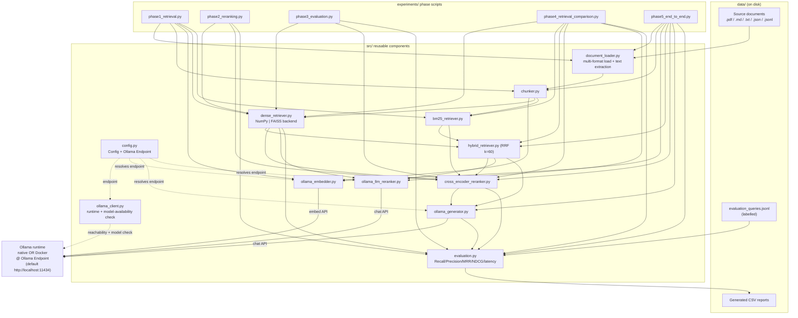

# Design Document

## Overview

The **RAG Retrieval and Reranking Evaluation Lab** is a local-first, educational Python project whose single guiding question is: *does reranking actually improve a RAG pipeline, and can we measure it?* Every component is built directly in Python — no LangChain, no LlamaIndex — so that chunking, embedding, retrieval, reranking, generation, and evaluation are all exposed and independently verifiable.

### Design Goals

- **Local-first.** Everything runs on the user's machine. Embeddings and answer generation use models served by a locally-running Ollama instance (native install *or* Docker container) reached through a single configurable endpoint. The cross-encoder reranker runs locally through Sentence Transformers / PyTorch. No paid or external inference APIs are ever called. (Requirements 1.6, 1.7, 4, 7, 13, 14, 17)
- **Transparent internals.** Dense similarity is implemented from scratch with NumPy so every ranking can be recomputed and explained. (Requirement 5)
- **Modular and swappable.** A uniform retriever interface makes dense / BM25 / hybrid interchangeable; a uniform reranker interface makes the cross-encoder and the LLM reranker interchangeable; the dense retriever's vector search sits behind a backend abstraction so NumPy and FAISS share one interface. Any single component can be replaced with zero edits to the phase scripts. (Requirements 1.1, 1.5, 12, 13, 16)
- **Measurement over anecdote.** A labelled evaluation dataset and standard ranking metrics (Recall@K, Precision@K, MRR@K, NDCG@K) plus separately-measured latency let us attribute any difference to reranking alone. (Requirements 9, 10, 11)

### The Five-Phase Progression

Each phase produces a runnable, verifiable deliverable before the next begins:

| Phase | Goal | Deliverable |
|-------|------|-------------|
| 1 | Build the retrieval engine from scratch (load → chunk → embed → index → retrieve) | `phase1_retrieval.py` printing ranked results + latency |
| 2 | Add a real cross-encoder reranker and observe reordering | `phase2_reranking.py` + Phase 2 CSV report |
| 3 | Evaluate retrieval & reranking scientifically with labelled data | `phase3_evaluation.py` + baseline/reranked/summary CSVs |
| 4 | Compare retrieval strategies (dense/BM25/hybrid) and rerankers (cross-encoder vs LLM) | `phase4_retrieval_comparison.py` + comparison report |
| 5 | Assemble a full local RAG app and judge whether reranking improves answers | `phase5_end_to_end.py` + end-to-end report |

### Core Measurement Principle

The lab runs a **controlled baseline-vs-reranked comparison**: the baseline and the reranked configuration operate on the *same candidate set*, the *same queries*, and the *same manually-assigned relevance labels*. Because the only variable is the reranking step, any metric movement is attributable to reranking. The design makes three distinctions first-class:

- **NDCG@5 improves while Recall@50 is unchanged** → the reranker *reordered* the same candidate set (it did not add documents).
- **Recall@5 improves** → relevant documents were *moved into the top 5* (not discovered by the reranker).
- **A relevant document missing from the candidate set can never appear in reranked output** → retrieval, not reranking, bounds recall.

## Architecture

### High-Level Pipeline



### End-to-End Data Flow

Source ingestion → text extraction → chunking → embedding (Ollama) → indexing → retrieval (dense / BM25 / hybrid-RRF) → reranking (cross-encoder / LLM) → generation (Ollama) → evaluation (metrics + latency → CSV).

### Ollama Endpoint Consumption

A single `Config` object resolves the Ollama Endpoint once (env var `OLLAMA_ENDPOINT` → config value → default `http://localhost:11434`). The three Ollama-dependent components — `OllamaEmbedder`, `OllamaGenerator`, and `OllamaLLMReranker` — all receive that same endpoint, so switching between a native install and a Docker container is purely a configuration change. (Requirements 17.1–17.4, 17.8). Before a phase that needs Ollama begins, an `OllamaClient` helper performs a startup reachability check and verifies the required models are present, failing with a descriptive error that names the endpoint and the missing model rather than falling back to any external API. (Requirements 1.7, 17.5, 17.6)

### How Phase Scripts Compose Components

Phase scripts contain *no reusable logic* — they import from `src/`, wire components together, run experiments, print or persist results, and nothing else. Because retrievers share one interface and rerankers share another, a phase script written against the interfaces runs unchanged when an implementation is swapped. (Requirements 1.1, 1.5)

## Components and Interfaces

All interfaces below are expressed as Python type hints / dataclasses. Signatures are illustrative and implementation-ready; they are not the full implementation.

### Shared Data Types (`src/types.py`)

```python
from dataclasses import dataclass, field
from typing import Optional

@dataclass(frozen=True)
class Document:
    """A stored unit of knowledge-base text."""
    doc_id: str          # unique across the knowledge base
    text: str            # non-empty extracted/record text
    source_path: str     # originating file
    metadata: dict = field(default_factory=dict)

@dataclass(frozen=True)
class Chunk:
    """A fixed-size, optionally overlapping segment of a document's text."""
    chunk_id: str        # unique across all chunks in a run
    doc_id: str          # parent document id
    text: str
    seq: int             # chunk sequence within the parent document

@dataclass(frozen=True)
class RetrievalResult:
    """One entry in a retriever's ranked candidate set."""
    doc_id: str          # chunk_id of the retrieved unit
    score: float         # retriever score (cosine, BM25, or RRF)
    rank: int            # 1-based position in the ranked list

@dataclass(frozen=True)
class RerankResult:
    """One entry in a reranker's output."""
    doc_id: str
    rerank_score: float  # raw comparison value, NOT a calibrated probability
    reranked_position: int   # 1-based position after reranking
    initial_rank: int        # 1-based position in the candidate set
    initial_score: float     # the retriever score it entered with
    parse_failed: bool = False  # LLM reranker only: response was unparseable
```

`RetrievalResult` and `RerankResult` are the contract across all retrievers and rerankers, which is what makes them interchangeable. (Requirements 1.5, 7.4, 7.5, 12, 13)

### `config.py` — Configuration & Endpoint Resolution

- **Responsibility:** Resolve all runtime settings, especially the Ollama Endpoint, from environment and/or config value with sane defaults.
- **Satisfies:** 17.1–17.4, 17.8, plus chunk/model defaults for 3, 4, 7, 14.

```python
@dataclass(frozen=True)
class Config:
    ollama_endpoint: str          # env OLLAMA_ENDPOINT -> value -> default
    embedding_model: str = "embeddinggemma"
    instruct_model: str = "qwen2.5:3b"
    chat_model: str = "qwen2.5:3b"
    cross_encoder_model: str = "cross-encoder/ms-marco-MiniLM-L6-v2"
    chunk_size: int = 512
    chunk_overlap: int = 64
    dense_backend: str = "numpy"  # "numpy" | "faiss"
    use_ragas: bool = False
    rrf_k: int = 60
    embed_timeout_s: int = 30
    generate_timeout_s: int = 60

    @classmethod
    def load(cls, overrides: Optional[dict] = None) -> "Config": ...

DEFAULT_OLLAMA_ENDPOINT = "http://localhost:11434"
```

Endpoint resolution order: `OLLAMA_ENDPOINT` env var → explicit config value → `DEFAULT_OLLAMA_ENDPOINT`.

### `ollama_client.py` — Runtime & Model-Availability Check

- **Responsibility:** Centralise the HTTP connection to the Ollama Endpoint and perform the startup reachability + model-availability check used by every Ollama-dependent phase.
- **Satisfies:** 1.7, 17.4, 17.5, 17.6, 17.8.

```python
class OllamaUnavailableError(RuntimeError): ...
class OllamaModelMissingError(RuntimeError): ...

class OllamaClient:
    def __init__(self, endpoint: str, *, timeout_s: int = 30): ...
    def ping(self) -> bool:
        """True if the endpoint responds; never falls back to a remote API."""
    def available_models(self) -> list[str]: ...
    def ensure_ready(self, required_models: list[str]) -> None:
        """Raise OllamaUnavailableError (naming endpoint) if unreachable,
        or OllamaModelMissingError (naming endpoint + model) if a model is absent."""
    def embed(self, model: str, text: str) -> list[float]: ...
    def chat(self, model: str, prompt: str, *, timeout_s: int) -> str: ...
```

### `document_loader.py` — Multi-Format Loading & Text Extraction

- **Responsibility:** Detect file type by extension, extract plain text (pypdf for PDF, UTF-8 for md/txt, structured records for json/jsonl), assign unique doc IDs, and build the knowledge base. Fail loudly on unsupported extensions, extraction failures, and duplicate IDs.
- **Satisfies:** 1.2, 1.3, 2.1–2.12.

```python
class UnsupportedFileTypeError(ValueError): ...
class ExtractionError(RuntimeError): ...
class DuplicateDocumentIdError(ValueError): ...

class DocumentLoader:
    SUPPORTED_EXT = {".pdf", ".md", ".txt", ".json", ".jsonl"}

    def __init__(self, config: Config): ...
    def load_file(self, path: str) -> list[Document]:
        """Extract text and return Documents. Raises on unsupported ext,
        extraction failure, empty/zero-record file, or duplicate ids."""
    def load_directory(self, data_dir: str) -> list[Document]:
        """Load all supported files; reject the whole load on duplicate doc_id."""
    def _assign_id(self, path: str, seq: int) -> str:
        """Non-JSON sources: '<filename>#<seq>'."""
```

Inputs: a file path or `data/` directory. Outputs: a list of `Document`, or a descriptive error naming the offending path and cause.

### `chunker.py` — Text Chunking

- **Responsibility:** Split extracted plain text into fixed-size, optionally overlapping chunks with unique chunk IDs; validate configuration.
- **Satisfies:** 3.1–3.7.

```python
class InvalidChunkConfigError(ValueError): ...

class Chunker:
    def __init__(self, chunk_size: int, chunk_overlap: int):
        """Raise InvalidChunkConfigError if size < 1, overlap < 0,
        or overlap >= size (message states allowed range)."""
    def chunk(self, doc: Document) -> list[Chunk]:
        """Sequential chunks of <= chunk_size units; consecutive chunks of the
        same doc share exactly chunk_overlap trailing units. Empty text -> []."""
```

### `ollama_embedder.py` — Embeddings via Ollama

- **Responsibility:** Produce fixed-dimension embeddings for queries and documents through the Ollama embedding API at the configured endpoint, validating input and response.
- **Satisfies:** 4.1–4.5, 17.4.

```python
class EmbeddingError(RuntimeError): ...

class OllamaEmbedder:
    def __init__(self, client: OllamaClient, model: str = "embeddinggemma"): ...
    @property
    def dimension(self) -> int:
        """Fixed embedding dimensionality for the session (queryable)."""
    def embed(self, text: str) -> list[float]:
        """Reject empty text or text > 2048 chars WITHOUT calling the API.
        Raise EmbeddingError on 30s timeout or malformed/wrong-dim response."""
    def embed_batch(self, texts: list[str]) -> list[list[float]]: ...
```

### `dense_retriever.py` — From-Scratch Dense Retrieval + Backend Abstraction

- **Responsibility:** Index document embeddings and return top-k by cosine similarity. Cosine is a from-scratch NumPy implementation. The vector-search step sits behind a backend interface so NumPy and FAISS are interchangeable.
- **Satisfies:** 5.1–5.7, 6.6, 16.1–16.5.

```python
class VectorBackend(Protocol):
    def build(self, matrix: "np.ndarray") -> None: ...
    def search(self, query_vec: "np.ndarray", k: int) -> tuple[list[int], list[float]]:
        """Return (indices, scores) for top-k, descending, ties by ascending index."""

class NumpyBackend(VectorBackend):
    """From-scratch cosine similarity; no external similarity/ranking lib."""

class FaissBackend(VectorBackend):
    """Optional. Same interface; raises VectorBackendError on init/search failure."""

class Retriever(Protocol):
    def retrieve(self, query: str, k: int) -> "RetrievalOutput": ...

@dataclass
class RetrievalOutput:
    results: list[RetrievalResult]
    latency_ms: float

class DenseRetriever(Retriever):
    def __init__(self, embedder: OllamaEmbedder, backend: VectorBackend): ...
    def index(self, chunks: list[Chunk]) -> None: ...
    def retrieve(self, query: str, k: int) -> RetrievalOutput:
        """Top-k by descending cosine (ties: ascending index). k<1 or empty
        collection -> empty results (no unhandled error). k>N -> all N.
        Zero-magnitude or dim-mismatch embedding -> error, no divide-by-zero.
        Reports latency_ms."""

    @staticmethod
    def cosine_similarity(a: "np.ndarray", b: "np.ndarray") -> float:
        """Bounded [-1, 1]; from scratch."""
```

The `Retriever` protocol (`retrieve(query, k) -> RetrievalOutput`) is the uniform interface shared by dense, BM25, and hybrid retrievers. (Requirements 1.5, 16.2)

### `bm25_retriever.py` — Keyword Retrieval

- **Responsibility:** Rank documents lexically using `rank-bm25`, exposing the same `Retriever` interface.
- **Satisfies:** 12.2, plus the shared retriever contract.

```python
class BM25Retriever(Retriever):
    def __init__(self): ...
    def index(self, chunks: list[Chunk]) -> None: ...
    def retrieve(self, query: str, k: int) -> RetrievalOutput:
        """Ranked list of 1..k (k in 1..1000) via rank-bm25; reports latency_ms."""
```

### `hybrid_retriever.py` — Reciprocal Rank Fusion

- **Responsibility:** Fuse the dense and BM25 ranked lists with RRF (`k=60`), never by adding raw cosine/BM25 scores.
- **Satisfies:** 12.3, plus the shared retriever contract.

```python
class HybridRetriever(Retriever):
    def __init__(self, dense: DenseRetriever, bm25: BM25Retriever, rrf_k: int = 60): ...
    def index(self, chunks: list[Chunk]) -> None: ...
    def retrieve(self, query: str, k: int) -> RetrievalOutput:
        """RRF score for doc d = sum over lists of 1/(rrf_k + rank_d).
        Returns top-k by descending fused score; reports latency_ms."""
```

### `cross_encoder_reranker.py` — Cross-Encoder Reranker (primary)

- **Responsibility:** Load `cross-encoder/ms-marco-MiniLM-L6-v2` locally via Sentence Transformers, score each candidate, and return candidates sorted by descending score with stable tie order.
- **Satisfies:** 7.1–7.9.

```python
class RerankerError(RuntimeError): ...
class ModelLoadError(RerankerError): ...

class Reranker(Protocol):
    def rerank(self, query: str,
               candidates: list[RetrievalResult],
               k: Optional[int] = None) -> "RerankOutput": ...

@dataclass
class RerankOutput:
    results: list[RerankResult]
    latency_ms: float

class CrossEncoderReranker(Reranker):
    def __init__(self, model_name: str = "cross-encoder/ms-marco-MiniLM-L6-v2"):
        """Raise ModelLoadError if the model cannot be loaded (no results)."""
    def rerank(self, query, candidates, k=None) -> RerankOutput:
        """One query-doc pair and one score per candidate. Sort by descending
        score, stable for ties. Return min(k, len) if k given; k<1 or non-int
        -> error. Empty candidates -> empty result, no error. Scores are raw
        comparison values, not probabilities."""
```

The `Reranker` protocol (`rerank(query, candidates, k) -> RerankOutput`) is the uniform interface shared by the cross-encoder and LLM rerankers. (Requirements 1.5, 13.4)

### `ollama_llm_reranker.py` — LLM Reranker (alternative, Phase 4)

- **Responsibility:** Prompt an Ollama-hosted instruct model to judge each candidate on a fixed 0–3 integer scale, parse the judgment programmatically, and reorder. Unparseable responses get the lowest score and are recorded, without aborting.
- **Satisfies:** 13.1–13.4, 17.4.

```python
class OllamaLLMReranker(Reranker):
    def __init__(self, client: OllamaClient, model: str = "qwen2.5:3b"): ...
    def rerank(self, query, candidates, k=None) -> RerankOutput:
        """Same prompt + 0-3 scale for every candidate. Parse to int 0..3.
        Unparseable -> score 0, RerankResult.parse_failed=True, continue.
        Return only received candidates, sorted descending."""
    @staticmethod
    def _parse_score(response: str) -> tuple[int, bool]:
        """Return (score, parse_failed)."""
```

### `ollama_generator.py` — Local Answer Generation (Phase 5)

- **Responsibility:** Build a context+query prompt, call the Ollama chat API, return an answer that cites supplied document IDs and refuses when context is insufficient.
- **Satisfies:** 14.1–14.6, 17.4.

```python
class GenerationError(RuntimeError): ...

@dataclass
class GenerationResult:
    answer: str
    citations: list[str]      # doc_ids drawn only from supplied chunks
    insufficient_context: bool
    latency_ms: float

class OllamaGenerator:
    def __init__(self, client: OllamaClient, model: str): ...
    def generate(self, query: str, chunks: list[Chunk]) -> GenerationResult:
        """Empty chunks -> 'no context available', no API call. Context lacks
        the answer -> 'cannot be determined from the context'. 60s timeout or
        failure -> GenerationError (no fabricated answer)."""
```

### `evaluation.py` — Metrics & Latency

- **Responsibility:** Compute Recall@5, Recall@50, Precision@5, MRR@10, NDCG@5 and report retrieval and reranking latency separately; handle empty lists, cutoffs beyond list length, and queries with no relevant docs.
- **Satisfies:** 10.1–10.6, 11, plus latency properties.

```python
@dataclass
class MetricResult:
    recall_at_5: float
    recall_at_50: float
    precision_at_5: float
    mrr_at_10: float
    ndcg_at_5: float
    retrieval_latency_ms: float
    reranking_latency_ms: float

class Evaluation:
    @staticmethod
    def recall_at_k(ranked: list[str], relevant: set[str], k: int) -> float: ...
    @staticmethod
    def precision_at_k(ranked: list[str], relevant: set[str], k: int) -> float: ...
    @staticmethod
    def mrr_at_k(ranked: list[str], relevant: set[str], k: int) -> float: ...
    @staticmethod
    def ndcg_at_k(ranked: list[str], graded: dict[str, int], k: int) -> float:
        """Graded labels when available; else binary. Empty list / K>len ->
        compute over available results without error."""
    @classmethod
    def evaluate(cls, ranked: list[str], relevant: set[str],
                 graded: Optional[dict[str, int]],
                 retrieval_latency_ms: float,
                 reranking_latency_ms: float) -> MetricResult:
        """Query with no relevant docs: Recall and MRR = 0, excluded from
        averages in a documented, consistent manner."""
```

## Data Models

### Source Document Formats (input, under `data/`)

| Extension | Handling | Doc ID source |
|-----------|----------|---------------|
| `.pdf` | Text extracted with pypdf (local, no API) | auto-generated `<filename>#<seq>` |
| `.md` / `.txt` | Read as UTF-8 plain text | auto-generated `<filename>#<seq>` |
| `.json` / `.jsonl` | Structured records, each with a unique id + non-empty text | the record's own id |

Unsupported extensions, PDFs that yield no extractable text, empty/zero-record files, and duplicate IDs are all rejected with a descriptive error. (Requirements 1.3, 2.1–2.8, 2.12)

### Evaluation Query Schema (`data/evaluation_queries.jsonl`)

One JSON object per line:

```json
{
  "query_id": "q001",
  "query": "What is reciprocal rank fusion?",
  "relevant_documents": ["rag_notes#3", "hybrid#1"],
  "graded_labels": { "rag_notes#3": 3, "hybrid#1": 2 }
}
```

- `query_id`: unique, non-empty string.
- `query`: non-empty string.
- `relevant_documents`: list of corpus document IDs (empty list when no corpus document answers the query).
- `graded_labels` (optional): map of doc_id → integer 0–3 (0 non-relevant, 3 fully relevant), used by NDCG when present.

The dataset holds 30–50 questions. Loading rejects duplicate `query_id`, missing/empty `query`, or a `relevant_documents` id that matches no corpus document, naming the offending record and field. (Requirements 9.1–9.6)

### CSV Report Schemas (output, under `data/`)

**Phase 2 report** — one row per candidate document per query:

| Field | Type | Meaning |
|-------|------|---------|
| `query_id` | str | the query |
| `document_id` | str | candidate chunk/doc id |
| `initial_rank` | int | 1-based rank before reranking |
| `initial_similarity_score` | float | retriever score at entry |
| `rerank_score` | float | reranker's raw score |
| `reranked_position` | int | 1-based rank after reranking |
| `is_relevant` | bool | from manual labels, never from reranker scores |

**Phase 3 — `baseline_results.csv` / `reranked_results.csv`** — per-query ranked results with the metric inputs for each configuration (query_id, ranked document_ids in order, per-query Recall@5, Recall@50, Precision@5, MRR@10, NDCG@5, retrieval_latency_ms, reranking_latency_ms).

**Phase 3 — `evaluation_summary.csv`** — one row per metric comparing the two configurations:

| Field | Meaning |
|-------|---------|
| `metric` | one of NDCG@5, Recall@5, Recall@50 (plus Precision@5, MRR@10) |
| `baseline` | baseline value |
| `reranked` | reranked value |
| `changed` | whether reranking changed the metric |
| `interpretation` | e.g. "NDCG@5 up / Recall@50 unchanged = reordering" |

(Requirements 8.3, 8.6, 11.3, 11.4, 11.5)

## Correctness Properties

*A property is a characteristic or behavior that should hold true across all valid executions of a system — essentially, a formal statement about what the system should do. Properties serve as the bridge between human-readable specifications and machine-verifiable correctness guarantees.*

The requirements define eight correctness properties. Each is restated below as a design-level invariant, with the component that owns it and the test that enforces it. Property reflection removed redundancy: the retriever ordering invariant and the reranker set-membership invariant are kept separate from the count invariant because each guards a distinct failure mode; Property 4 is retained as a distinct property (not folded into Property 3) because it encodes the retrieval→reranking recall boundary that the whole lab is built to measure.

### Property 1: A retriever never returns more than the requested count, with no duplicates

*For any* document collection, query, and requested top-k value, every retriever (dense, BM25, hybrid) returns at most `min(k, N)` results and never returns the same document id more than once.

- **Enforced by:** `DenseRetriever`, `BM25Retriever`, `HybridRetriever` (shared `Retriever` interface).
- **Test:** property test over random corpora and k values asserting `len(results) <= min(k, N)` and unique ids (embedder mocked).
- **Validates: Requirements 5.3, 16.1**

### Property 2: A reranker returns scores sorted descending, stable for ties

*For any* query and candidate set, a reranker's output is ordered by non-increasing `rerank_score`, and candidates with equal scores preserve their relative order from the received candidate set.

- **Enforced by:** `CrossEncoderReranker`, `OllamaLLMReranker` (shared `Reranker` interface).
- **Test:** property test with a mocked scoring model over random candidate sets asserting non-increasing scores and stable tie order.
- **Validates: Requirements 7.4, 13.4**

### Property 3: Every reranked document came from the candidate set exactly once

*For any* candidate set passed to a reranker, every document in the output was present in that candidate set, no document appears more than once, and the output count never exceeds the candidate count.

- **Enforced by:** `CrossEncoderReranker`, `OllamaLLMReranker`.
- **Test:** property test asserting output ids are a duplicate-free subset of input ids and `len(output) <= len(input)`.
- **Validates: Requirements 7.5, 13.4**

### Property 4: A relevant document outside the candidate set cannot appear in reranked results

*For any* candidate set and *any* relevant document that is not a member of that candidate set, the reranked output does not contain that document, and the Phase 2 report records it as absent from both the candidate set and the reranked results.

- **Enforced by:** rerankers (membership) + `phase2_reranking.py` (reporting).
- **Test:** property test constructing candidate sets that exclude a known relevant doc and asserting its absence from rerank output.
- **Validates: Requirements 8.7, 7.5**

### Property 5: Evaluation metrics match independently hand-calculated examples

*For any* ranked result list and relevance labels, each computed metric (Recall@5, Recall@50, Precision@5, MRR@10, NDCG@5) equals an independently hand-calculated value for the same inputs within an absolute tolerance of 0.0001; and across all inputs the metrics stay within their mathematical bounds (Recall/Precision/MRR/NDCG ∈ [0, 1], Recall@K non-decreasing in K, ideal ordering yields NDCG@5 = 1).

- **Enforced by:** `evaluation.py`.
- **Test:** example-based fixtures with hand-calculated expected values (tolerance 1e-4) **plus** property tests for the bounds / monotonicity / ideal-ordering invariants.
- **Validates: Requirements 10.2**

### Property 6: An empty candidate list is handled without error

*For any* component that consumes a candidate or ranked list, an empty input produces a sensible empty/zero result without raising an unhandled error, and a cutoff K larger than the list length is computed over the available results.

- **Enforced by:** `CrossEncoderReranker`, `OllamaLLMReranker`, `DenseRetriever`, `evaluation.py`.
- **Test:** property generators include empty and under-K lists; assert no exception and empty/zero outputs.
- **Validates: Requirements 7.8, 5.5, 10.6**

### Property 7: Retrieval latency and reranking latency are measured separately

*For any* evaluated query, the result exposes a retrieval latency and a reranking latency as two distinct, independently-populated numeric millisecond fields (the baseline configuration carries no reranking latency contribution, the reranked configuration carries both).

- **Enforced by:** `RetrievalOutput.latency_ms`, `RerankOutput.latency_ms`, `MetricResult.{retrieval_latency_ms, reranking_latency_ms}`.
- **Test:** example test asserting both fields are present, numeric, non-negative, and set independently for baseline vs reranked.
- **Validates: Requirements 10.3**

### Property 8: Results are reproducible across runs

*For any* fixed inputs (query, document set, chunk size, chunk overlap), repeated runs produce identical rankings and scores, and dense cosine similarity matches an independent NumPy recomputation within 1e-6.

- **Enforced by:** `DenseRetriever` (deterministic cosine + tie-break), `evaluation.py` (deterministic metrics).
- **Test:** property test running retrieval/metrics twice on identical fixed inputs (embedder mocked) asserting identical rankings and scores, and cross-checking cosine against an independent recomputation within 1e-6.
- **Validates: Requirements 6.6, 11.6**

### Supplementary Property (optional, phase-gated): FAISS matches the NumPy reference

*For any* embedding set and query, when FAISS is enabled, the FAISS backend's top-k ordering matches the from-scratch NumPy backend for at least 99% of returned positions, with per-document scores differing by no more than 0.0001. This is a model-based property using NumPy as the reference oracle; it is skipped when FAISS is not installed.

- **Enforced by:** `FaissBackend` vs `NumpyBackend`.
- **Validates: Requirements 16.3**

## Per-Phase Design

Every phase script imports from `src/` only, wires components through their shared interfaces, and emits a verifiable deliverable. No reusable logic lives in `experiments/`. (Requirement 1.1)

### Phase 1 — `phase1_retrieval.py` (Retrieval engine from scratch)

- **Wires:** `Config` → `OllamaClient.ensure_ready([embeddinggemma])` → `DocumentLoader` → `Chunker` → `OllamaEmbedder` → `DenseRetriever` (NumPy backend) and `BM25Retriever`.
- **Deliverable:** prints the original query, retrieved document IDs, each similarity score to ≥4 decimal places, the ranked contents in descending similarity order, and retrieval time in ms; prints the keyword (BM25) ranking and the semantic (dense) ranking side by side.
- **Experiments:** configurable query text, chunk size (50–2048), chunk overlap (0..size-1); invalid query (empty / >2048 chars) and invalid chunk config are rejected with range-naming errors before any retrieval. Reproducibility is asserted: identical inputs across runs give identical rankings and cosine scores matching an independent recomputation within 1e-6.
- **Validates:** 5, 6.1–6.6, 2, 3, 4.

### Phase 2 — `phase2_reranking.py` (Cross-encoder reranking)

- **Wires:** reuses the Phase 1 candidate set → `CrossEncoderReranker.rerank(query, candidates, k=5)` → Phase 2 CSV writer.
- **Deliverable:** top-5 reranked documents; a persisted CSV with `query_id, document_id, initial_rank, initial_similarity_score, rerank_score, reranked_position, is_relevant`; the written report's path is reported. `is_relevant` comes from manual labels, never from reranker scores.
- **Methodology / experiments:** (a) initial retrieval only, (b) retrieve 20 / rerank 20, (c) 50/50, (d) 100/100, (e) reworded query, (f) candidate set with an inserted irrelevant document. Each candidate's `initial_rank`↔`reranked_position` and `initial_similarity_score`↔`rerank_score` pairing is recorded so any single document's movement is explained by its two scores; the movement of `is_relevant=true` documents is read by comparing `initial_rank` against `reranked_position`. A relevant document absent from the candidate set is recorded as absent from both candidate set and reranked results (Property 4). Empty/unavailable candidate set → descriptive error, no report for that query.
- **Validates:** 7, 8.

### Phase 3 — `phase3_evaluation.py` (Scientific baseline-vs-reranked)

- **Wires:** load `evaluation_queries.jsonl` → for each query obtain *one* initial candidate set → evaluate a **Baseline** configuration (candidate set unchanged) and a **Reranked** configuration (same candidate set, cross-encoder applied) → `Evaluation.evaluate(...)` → CSV writers.
- **Controlled methodology:** baseline and reranked share identical queries, documents, relevance labels, and initial candidate set. If the two configurations do not share an identical candidate set for a query, the script errors for that query and reports no comparison — guaranteeing any metric difference is attributable to reranking alone.
- **Deliverable:** `baseline_results.csv`, `reranked_results.csv`, `evaluation_summary.csv` (NDCG@5, Recall@5, Recall@50 for both configs, whether each metric changed, and an interpretation column). The summary documents the two key distinctions: **improved NDCG@5 with unchanged Recall@50 = reordering of the same candidate set** (not a content change); **improved Recall@5 = relevant documents moved into the top 5** (not the reranker discovering new documents). Reproducible across runs (Property 8).
- **Validates:** 9, 10, 11.

### Phase 4 — `phase4_retrieval_comparison.py` (Strategy & reranker comparison)

- **Wires:** `DenseRetriever`, `BM25Retriever`, `HybridRetriever` (RRF k=60), `CrossEncoderReranker`, `OllamaLLMReranker`, `Evaluation`.
- **Retrieval comparison:** exactly five configurations — dense (no rerank), BM25 (no rerank), dense + cross-encoder, hybrid (no rerank), hybrid + cross-encoder — over the identical labelled question set and identical candidate set for configs sharing a retrieval stage; records Recall@5, Recall@50, Precision@5, MRR@10, NDCG@5 for each. A failing configuration is recorded with the failed config + affected question, excluded, and execution continues.
- **Reranker comparison:** cross-encoder vs Ollama LLM reranker over the same candidate set and questions; records NDCG@5, MRR@10, pre-rerank Recall@50, reranking latency (ms), peak memory, number of model evaluations, and top-5 ranking consistency across ≥3 repeated runs. The LLM reranker is treated as experimental — no assumption it beats the cross-encoder. Unparseable LLM responses get the lowest score and are recorded as parse failures without aborting.
- **Validates:** 12, 13, 16.

### Phase 5 — `phase5_end_to_end.py` (Full local RAG + answer evaluation)

- **Wires:** `DocumentLoader` → `Chunker` → `OllamaEmbedder` → retriever (dense/hybrid) → `CrossEncoderReranker` → `OllamaGenerator` → `Evaluation` (+ optional Ragas), all on the local machine.
- **Methodology:** each test question is answered twice — once on **baseline** retrieval results, once on **reranked** results — and the two runs are reported side by side: answer correctness (manual), faithfulness, context relevance, citation accuracy (manual), and latency in seconds. Both retrieval metrics and answer-quality metrics are reported per configuration so one can observe directly whether improved retrieval coincides with improved answers. A failing pipeline stage is recorded (naming the stage + question) and evaluation continues. After all questions, the best-performing retrieval + reranking configuration on the labelled dataset is identified.
- **Validates:** 14, 15.

## Error Handling

| Failure condition | Component | Behavior | Requirement |
|-------------------|-----------|----------|-------------|
| Ollama Endpoint unreachable | `OllamaClient.ensure_ready`, embedder, generator, LLM reranker | `OllamaUnavailableError` naming the configured endpoint; no fallback to any external/paid API | 1.7, 4.4, 14.6, 17.6 |
| Required model missing | `OllamaClient.ensure_ready` | `OllamaModelMissingError` naming the endpoint **and** the missing model; no fallback | 1.7, 17.5, 17.6 |
| Embedding timeout (30s) | `OllamaEmbedder` | `EmbeddingError` (connection failure); no partial/empty vector | 4.4 |
| Malformed / wrong-dimension embedding response | `OllamaEmbedder` | `EmbeddingError`; do not return the malformed vector | 4.5 |
| Empty or >2048-char embed input | `OllamaEmbedder` | reject before calling the API | 4.3 |
| PDF cannot be opened / yields no text | `DocumentLoader` | `ExtractionError` naming the file | 1.3, 2.7 |
| Unsupported file extension | `DocumentLoader` | `UnsupportedFileTypeError` naming the type; skip/reject | 1.3, 2.6 |
| Missing / empty / zero-record source file | `DocumentLoader` | error naming the cause; knowledge base left unpopulated | 2.12 |
| Duplicate document ID | `DocumentLoader` | `DuplicateDocumentIdError`; whole load rejected, no partial data | 1.3, 2.8 |
| Invalid chunk config (overlap ≥ size, size < 1, overlap < 0) | `Chunker` | `InvalidChunkConfigError` naming the parameter + allowed range; no chunks | 3.5, 3.6 |
| Empty document text | `Chunker` | produce zero chunks, return successfully | 3.7 |
| Invalid evaluation record (dup query_id, empty query, unknown relevant doc id) | eval-dataset loader | reject naming the offending record + field | 9.6 |
| Cross-encoder model cannot load | `CrossEncoderReranker` | `ModelLoadError`; no reranked documents | 7.2 |
| Invalid top-k (< 1 or non-integer) | reranker / retriever | error indicating invalid top-k; no results | 5.5, 7.7, 16.5 |
| Empty candidate set | reranker | empty result, no error (Property 6) | 7.8 |
| Empty ranked list / K > list length | `evaluation.py` | compute over available results, no error | 10.6 |
| LLM reranker unparseable response | `OllamaLLMReranker` | assign lowest score (0), set `parse_failed=True`, record it, continue with remaining candidates | 13.3 |
| Generation: empty chunk list | `OllamaGenerator` | "no context available" response; do **not** call the chat API | 14.5 |
| Generation: context lacks the answer | `OllamaGenerator` | "cannot be determined from the context"; no unsupported content | 14.4 |
| Generation timeout (60s) / failure | `OllamaGenerator` | `GenerationError`; no fabricated answer | 14.6 |
| FAISS backend init/search failure | `DenseRetriever`/`FaissBackend` | error "vector search backend unavailable"; preserve index; no partial results | 16.4 |
| Phase stage failure (Phase 4 config / Phase 5 question) | phase scripts | record error naming failed config/stage + affected question; exclude it; continue remaining | 12.6, 15.6 |

## Testing Strategy

A dual approach: **example-based unit tests** for concrete behaviour and edge/error cases, and **property-based tests** (via the Hypothesis library) for the universal invariants in the Correctness Properties section.

### Unit tests (per component)

- `document_loader`: each extension path; unsupported extension, PDF extraction failure, empty file, duplicate id (error cases).
- `chunker`: exact chunk boundaries and overlap on a known string; invalid-config and empty-text cases.
- `ollama_embedder`: input validation (empty / >2048) and response validation, with the Ollama client mocked.
- `dense_retriever`: cosine on hand-computed vectors; tie-breaking; k>N; zero-magnitude / dim-mismatch errors.
- `bm25_retriever`, `hybrid_retriever`: RRF fusion on a hand-worked example (k=60).
- `cross_encoder_reranker`: ordering, top-k slicing, invalid top-k, model-load failure (model mocked).
- `ollama_llm_reranker`: 0–3 parsing, the unparseable→score-0 path, with the client mocked.
- `ollama_generator`: empty-chunk short-circuit, insufficient-context refusal, timeout error (client mocked).
- `evaluation`: metric correctness against hand-calculated fixtures.

### Property-based tests (Hypothesis)

One Hypothesis test per correctness property (minimum **100 iterations** each), each tagged with a comment referencing its design property:

```
# Feature: rag-reranking-lab, Property 1: A retriever never returns more than the requested count, with no duplicates
```

- Property 1 — retriever count/uniqueness over random corpora + k (dense/BM25/hybrid, embedder mocked).
- Property 2 — reranker descending-sorted, stable ties, over random candidate sets (scorer mocked).
- Property 3 — reranker output is a duplicate-free subset of the candidate set.
- Property 4 — a relevant doc excluded from the candidate set is absent from rerank output.
- Property 5 — metric bounds/monotonicity/ideal-ordering invariants (exact values covered by example fixtures below).
- Property 6 — empty / under-K lists handled by rerankers, retrievers, and metrics without error.
- Property 7 — latency fields present, numeric, non-negative, independently set.
- Property 8 — determinism across two runs + cosine cross-check within 1e-6.
- Supplementary — FAISS vs NumPy model-based agreement, `@skipif` FAISS not installed.

### Example-based metric fixtures (Property 5, exact values)

Small fixed ranked lists with manually computed Recall@5, Precision@5, MRR@10, and NDCG@5 (including a graded-relevance NDCG example and a no-relevant-docs query), each asserted to within 1e-4. These fixtures are the independent oracle the property test's "match hand-calculated example" clause refers to.

### Testing Ollama-dependent components

The embedder, generator, and LLM reranker depend on a live model, so unit and property tests run against a **mocked `OllamaClient`** (deterministic embeddings, chat responses, and model lists) — no live model required, and tests are fully deterministic. A small set of **optional integration tests**, guarded by an environment flag and a live-endpoint reachability check, exercise the real local Ollama instance (pull `embeddinggemma` and the instruct model first); they are skipped automatically when the endpoint is not reachable.

## Ollama Runtime & Deployment

Ollama runs **locally only** — never a cloud or hosted service — and is reachable at the single configurable Ollama Endpoint. Native installation and Docker are equally supported; Docker is optional. (Requirements 17.1–17.8)

### Endpoint configuration

- Environment variable `OLLAMA_ENDPOINT` (highest precedence), then a config value, then the default `http://localhost:11434`.
- All three Ollama-dependent components (`OllamaEmbedder`, `OllamaGenerator`, `OllamaLLMReranker`) consume the **same** resolved endpoint, so changing runtimes is a configuration change with no source edits.

### Native install

```
# install Ollama for your OS, then:
ollama serve                      # serves at http://localhost:11434
ollama pull embeddinggemma
ollama pull qwen2.5:3b            # instruct model for generation + LLM reranker
# OLLAMA_ENDPOINT unset -> default http://localhost:11434 is used
```

### Docker (optional, equally supported)

```
docker run -d --name ollama -p 11434:11434 -v ollama:/root/.ollama ollama/ollama
docker exec -it ollama ollama pull embeddinggemma
docker exec -it ollama ollama pull qwen2.5:3b
# published port 11434 on localhost -> default endpoint still works, or set:
#   export OLLAMA_ENDPOINT=http://localhost:11434
```

### Startup check

Before any phase that needs Ollama, `OllamaClient.ensure_ready([...])` verifies the endpoint is reachable and the required models are present, raising a descriptive error that names the endpoint and any missing model. The README documents both runtimes, model pulls, and the endpoint variable, and states that a native installation is sufficient (Docker not required). (Requirement 17.7)

## Dependencies

All dependencies are local Python packages; none call an external inference API.

| Package | Purpose | Phase / status |
|---------|---------|----------------|
| `numpy` | from-scratch cosine similarity, vector math | Phase 1, core |
| `pandas` | CSV reports and metric tables | Phase 2–5, core |
| `ollama` (Python client) | embedding + chat calls to the local endpoint | Phase 1/5, core |
| `sentence-transformers` | load & run the cross-encoder locally | Phase 2, core |
| `torch` | backend for sentence-transformers (local PyTorch) | Phase 2, core (pulled in by sentence-transformers) |
| `rank-bm25` | BM25 keyword retrieval | Phase 4, core |
| `pypdf` | local PDF text extraction | Phase 1, core (loader) |
| `hypothesis` | property-based testing of correctness invariants | dev/test |
| `faiss-cpu` | optional efficient vector-search backend | Phase 1/4, **optional** |
| `ragas` | optional answer-quality evaluation | Phase 5, **optional** |

Optional packages (`faiss-cpu`, `ragas`) are phase-gated: the lab runs end to end without them (NumPy backend and manual answer assessment are the defaults), and they are enabled through `Config` flags (`dense_backend="faiss"`, `use_ragas=True`). The LangChain and LlamaIndex libraries are deliberately **not** dependencies. (Requirements 1.4, 4, 16, 15.4)
